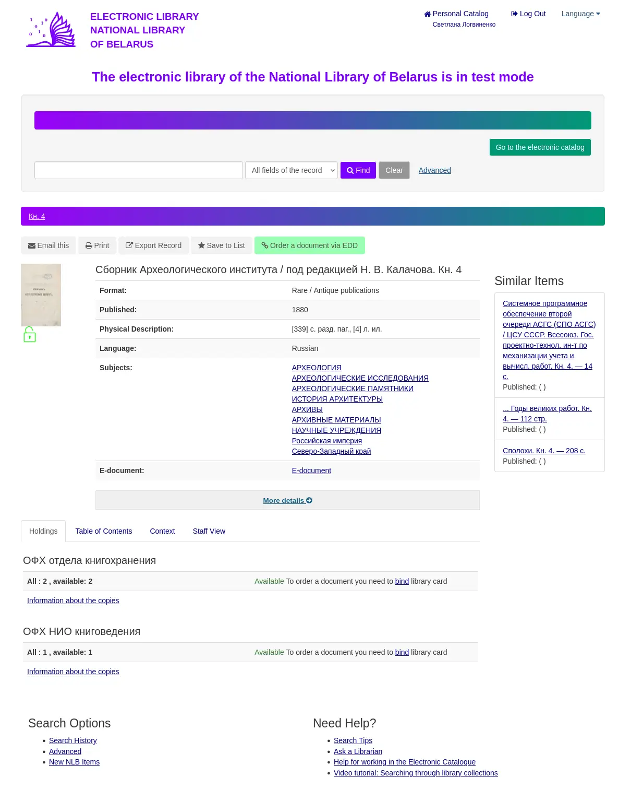

# National Library of Belarus (`elib.nlb.by`) to Wikimedia Commons Uploader

[](https://github.com/vitaly-zdanevich/nlb/actions/workflows/ci.yml)
[](https://sonarcloud.io/summary/new_code?id=vitaly-zdanevich_nlb)
[](https://sonarcloud.io/summary/new_code?id=vitaly-zdanevich_nlb)
[](https://sonarcloud.io/summary/new_code?id=vitaly-zdanevich_nlb)
[](https://sonarcloud.io/summary/new_code?id=vitaly-zdanevich_nlb)
[](https://sonarcloud.io/summary/new_code?id=vitaly-zdanevich_nlb)
[](upload.py)
[](test_upload.py)

[`upload.py`](upload.py) iterates over open-access digitized scans from the Electronic Library of the National Library of Belarus (`https://elib.nlb.by`) and uploads them to Wikimedia Commons with full HTML and UNIMARC (`MARCXML`) metadata.



## Features

- **Default year boundary (`<= 1900`)**: By default, queries digitized records published up to 1900 and applies `{{PD-scan|PD-old-assumed-expired}}`.
- **Configurable year range and custom URLs**: Supports `--from-year`, `--to-year` (`--until-year`), or passing a custom `elib.nlb.by` search or record URL directly.
- **Original title extraction**: Extracts the full title from the record page heading (`<h1>` / `<h3 property="name">`) and UNIMARC `200$a` + `961$a` / `461$a` parent work fields so multi-volume child records retain the work's full title instead of just a volume label such as `T. 2`.
- **Alternate indexing terms and place names**: Preserves NLB `908` genre variants and `926` geographic name variants, including translations, synonyms and historical names. Variants are grouped with their `608` / `620` headings using authority IDs; unlinked variants remain visible. Repeated aliases are deduplicated, and geographic subdivisions stay attached to the appropriate name.
- **Contributor roles**: Preserves UNIMARC `700`–`702` / `710`–`712` contributors with all `$4` role codes and `$5` copy associations. Authors, translators, editors, compilers, publishers, issuing bodies and former owners of a physical copy are distinguished in the description; unknown codes remain visible. The Commons author field uses explicit author role `070`, or primary/equal responsibility (`700` / `701` / `710` / `711`) when no role is recorded. Uncoded secondary contributors remain visible with an unspecified role. HTML author lists and responsibility statements remain preserved, but only provide an author fallback when there are no structured contributors.
- **Ownership scope**: Roles are attributed to the NLB catalog. Former-owner entries explicitly state that their association with the scanned copy has not been established. Copy references in contributor fields and MARC `3xx` notes remain attached to their respective entries; the uploader does not infer a contributor's copy from a separate note or match catalog copies to scans.
- **Single-file and multi-part (`METS`) support**: Resolves both direct `fileID` viewer links and multi-volume `metsID` document trees on `https://elib.nlb.by:8070`.
- **SHA-1 deduplication**: Computes the digest with Python's `hashlib` and queries the MediaWiki `allimages` API directly. No shell helper is required. Timeouts, broken connections, invalid JSON and HTTP 500/502/503/504 receive up to five attempts with 5, 10, 20 and 40 seconds between attempts; failed or invalid lookups leave the scan pending without uploading.
- **Resumable state**: Saves progress atomically in `state.json` after each item and page so interrupted runs continue from the exact item on restart.
- **Automatic cleanup**: Deletes each temporary PDF scan locally immediately after uploading or skipping.
- **Download size in progress output**: Shows the server's advertised size before streaming, such as `Downloading scan (54.4 MB):`, using decimal MB with one decimal place. If the size is unavailable or invalid, it is omitted. The subsequent SHA-1 check message does not repeat the size.
- **Download retries**: Retries manifest/download timeouts, connection failures and interrupted PDF transfers up to five total attempts, waiting 5, 10, 20 and 40 seconds. Each retry discards the partial PDF and starts again. If all attempts fail, the scan stays pending in `state.json` for the next run.
- **Skip rejected downloads**: HTTP 400 during a download, including `Security alert! Some conditions are missed!`, is logged and saved as `download_rejected` with the library's response. The uploader deletes the temporary file and continues to the next scan, without retrying, hashing or uploading the rejected download. Other errors retain their existing handling.
- **Revisit rejected scans**: Rejections are counted in the final summary and remain pending in `state.json`. The next run resumes from the earliest rejected page, skipping completed uploads. A dry run preserves these pending uploads; changing the search URL or year filters resets the page cursor for the new search.
- **CSRF token recovery**: Each Commons upload request uses the current cached token, including later chunks, status polls and final publication. An expired token is refreshed once per request; persistent `badtoken` errors stop the upload and leave the item pending for a later run.
- **Graceful `Ctrl-C` shutdown**: The first `Ctrl-C` finishes the current item in progress, updates `state.json`, prints the uploaded file count and uploaded megabytes, and exits cleanly. A second `Ctrl-C` aborts the current operation, removes the temporary PDF and exits with code 130. Unfinished items remain pending; restarting checks Commons again before uploading.

## Duplicate Titles and SHA-1 Deduplication

1. **Unique filename suffix (`-- <marcID> -- <fileID>.pdf`)**:
   Every target Commons filename is formatted as:
   ```text
   <Title> (<Year>) -- <marcID> -- <fileID>.pdf
   ```
   Because both the NLB record ID (`marcID`) and file ID (`fileID`) are appended, two distinct NLB records or volumes that share the same book title will not collide on Wikimedia Commons.
2. **When the target Commons `File:` title already exists (`existing_title`)**:
   Before downloading the PDF scan, [`process_single_scan`](upload.py) calls `uploader.title_exists(commons_filename)`. If `File:<commons_filename>` already exists on Wikimedia Commons, the script logs `Skipping (title exists on Commons): File:<commons_filename>`, records `"status": "existing_title"` in `state.json`, and skips the item without downloading or overwriting it. If the title is created concurrently right before upload, `CommonsUploader.upload` also catches Pywikibot's `exists` status and skips the item.
3. **When the same PDF was already uploaded under a different title (`duplicate_sha1`)**:
   - If the item key `<marcID>:<fileID>` is already marked as completed in `state.json`, it is skipped before any network download.
   - If `state.json` does not have the item (or was reset), the script downloads the PDF to `--staging-dir` and checks its SHA-1 digest on Wikimedia Commons via `check_commons_by_hash`. When Commons reports an existing file with the same SHA-1 (even under an older or different title), the script logs `Skipping (duplicate SHA-1 on Commons: [...])`, records `"status": "duplicate_sha1"` in `state.json`, deletes the temporary PDF, and skips uploading.

## Usage

The former `--find-by-hash-script` option has been removed; SHA-1 checks always use the Python API client.

If downloads work in your signed-in browser but the uploader receives HTTP 400, export the cookies for `nlb.by` and its subdomains in Netscape `cookies.txt` format after opening the library viewer. Pass that local file with `--viewer-cookies`. It must include a current `elib_session_id` for the viewer and the cookies from your signed-in session. The uploader imports cookies applicable to `elib.nlb.by`, including cookies explicitly shared across NLB subdomains, and preserves their expiry, path and secure attributes along with the viewer session. Re-export the file after signing in again if the session expires.

```bash
chmod 600 ~/.config/nlb/cookies.txt
./upload.py --viewer-cookies ~/.config/nlb/cookies.txt
```

```bash
# Run with defaults (all open-access scans published up to 1900)
./upload.py

# Adjust publication year bounds
./upload.py --from-year 1850 --to-year 1900

# Process a specific search results URL or record URL
./upload.py 'https://elib.nlb.by/elib/Search/Results?type=AllFields&isElib=true&daterange%5B%5D=publishDate&publishDatefrom=&publishDateto=1917'

# Dry run (download and SHA-1 check without uploading)
./upload.py --dry-run --max-uploads 5
```

## Running Tests

The upload integration tests use Pywikibot's real request and chunk-upload code with mocked HTTP responses and an isolated configuration directory. They do not use your credentials or upload files.

```bash
python -m pip install pytest pytest-cov requests beautifulsoup4 'pywikibot>=11.6'
pytest -v --cov=upload --cov-report=term-missing
# or
python3 -m unittest -v test_upload.py
```

## Related Documentation

- [Electronic Library of the National Library of Belarus (`elib.nlb.by`)](https://elib.nlb.by/)
- [VuFind Documentation](https://vufind.org/wiki/documentation)
- [IIIF Presentation API Specification](https://iiif.io/api/presentation/2.1/)
- [MARC 21 / UNIMARC XML Schema (Library of Congress)](https://www.loc.gov/standards/marcxml/)
- [UNIMARC contributor role codes: IFLA Appendix B](https://cdn.ifla.org/wp-content/uploads/files/assets/uca/unimarc_updates/BIBLIOGRAPHIC/u_b_appb_update2020_online_final.pdf)
- [Python cookie handling and Netscape cookie files](https://docs.python.org/3/library/http.cookiejar.html#http.cookiejar.MozillaCookieJar)
- [MediaWiki API: `allimages` (SHA-1 lookup)](https://www.mediawiki.org/wiki/API:Allimages)
- [Pywikibot Documentation](https://doc.wikimedia.org/pywikibot/stable/)
- [Wikimedia Commons Licensing Policy](https://commons.wikimedia.org/wiki/Commons:Licensing)
